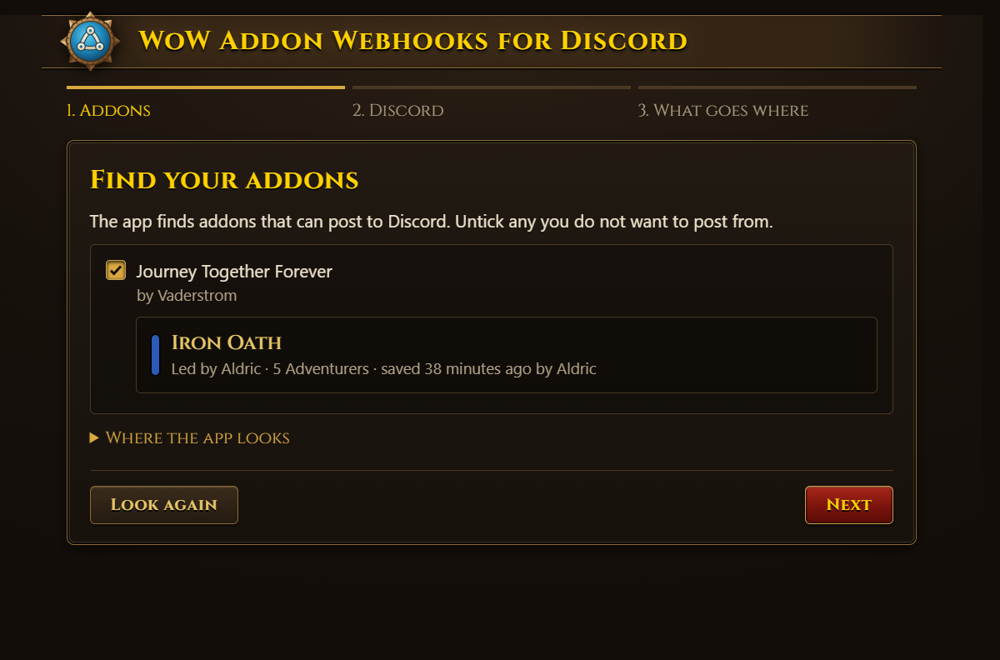
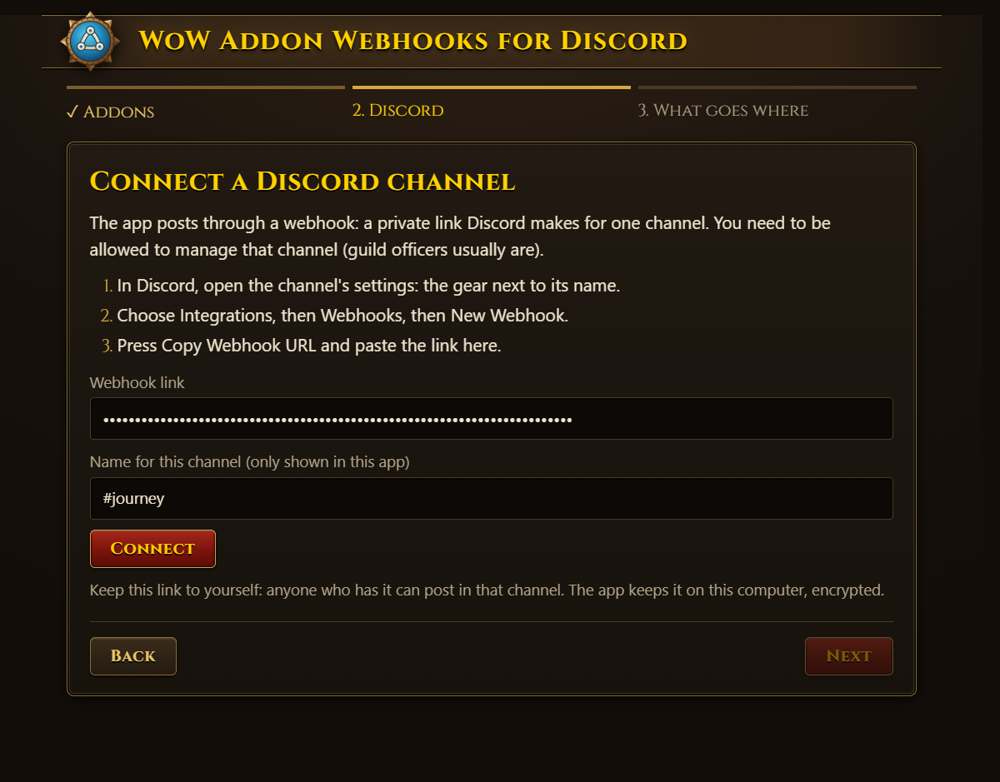
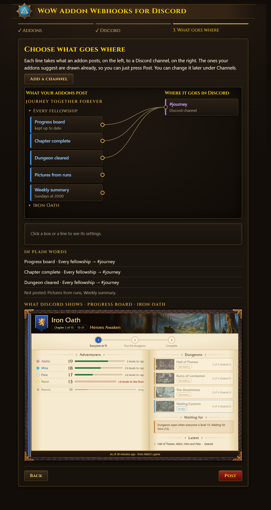
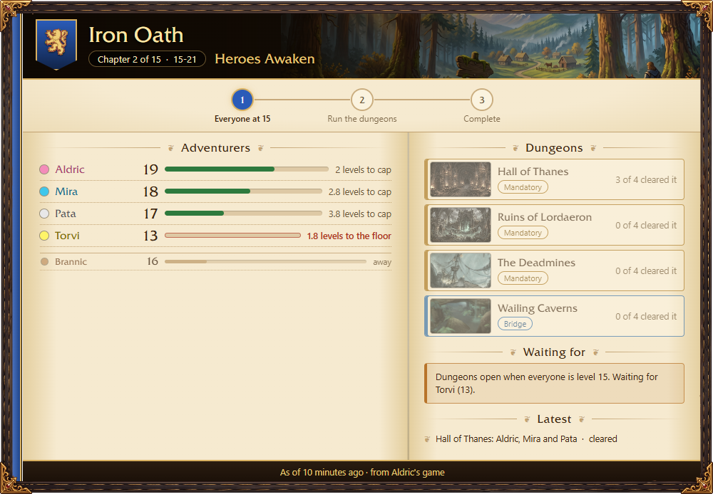
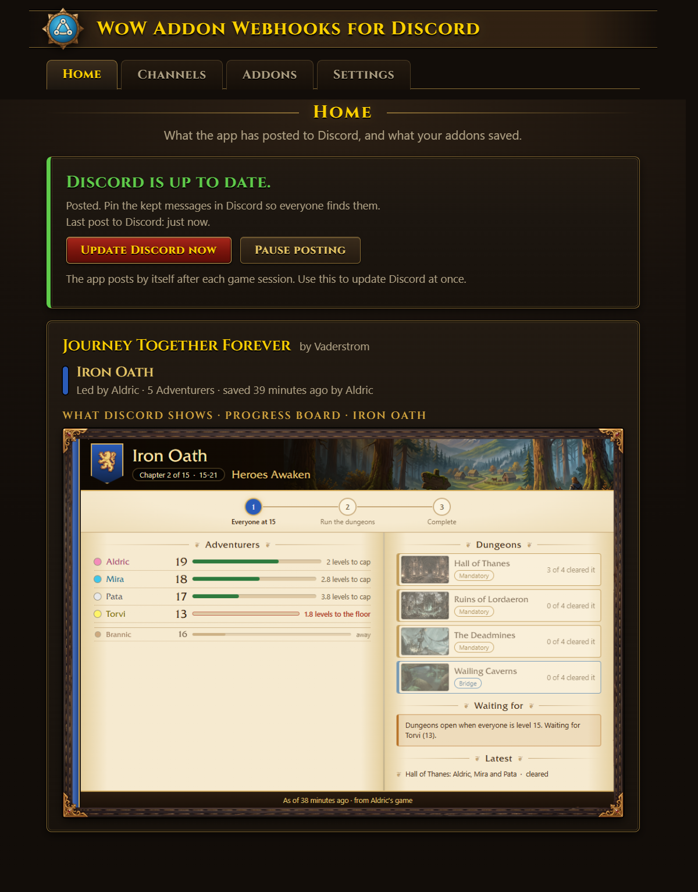
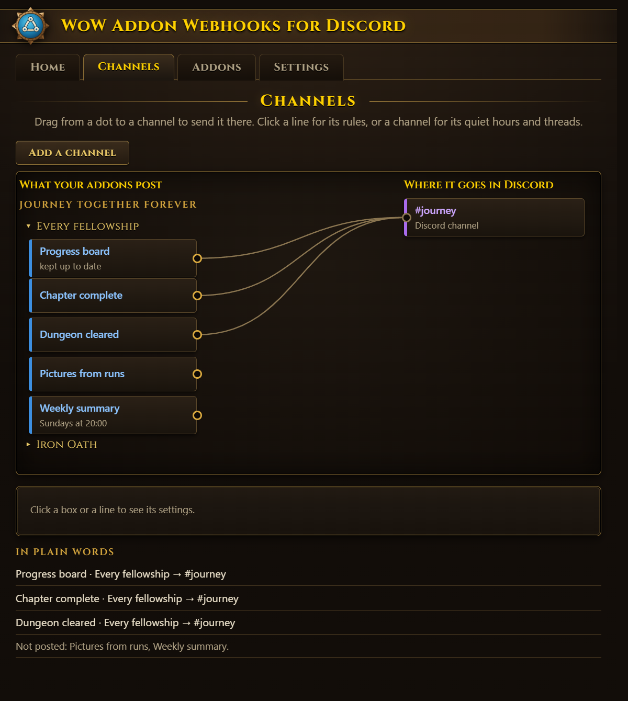
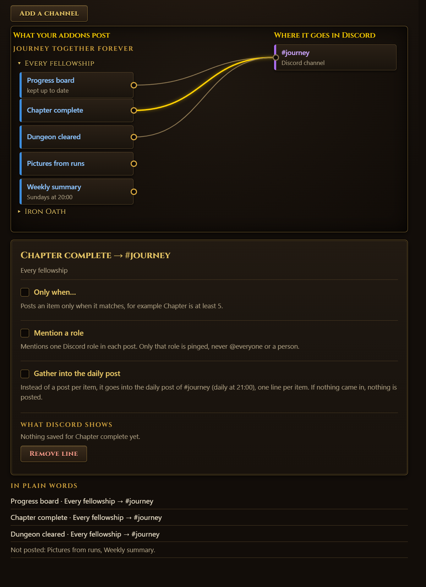
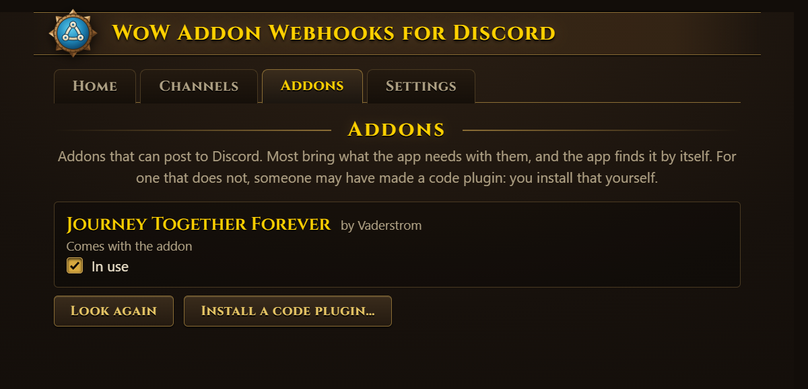
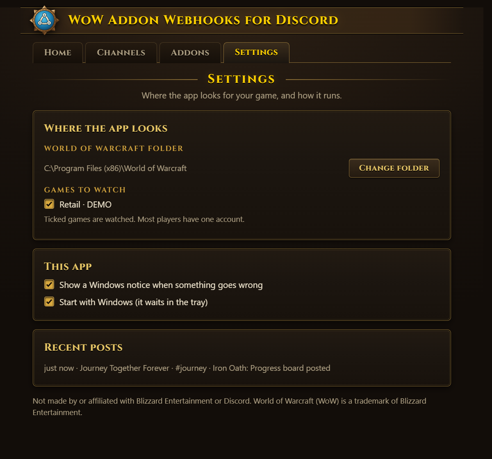

# WoW Addon Webhooks for Discord: the manual

How to install the app, set it up in three steps, and decide what goes where in Discord. The pictures show a made-up
fellowship, Iron Oath, from Journey Together Forever.

- [Install](#install)
- [The first start: three steps](#the-first-start-three-steps)
- [What Discord gets](#what-discord-gets)
- [Home](#home)
- [Channels: what goes where](#channels-what-goes-where)
- [Addons](#addons)
- [Settings](#settings)
- [Updates](#updates)
- [When something does not post](#when-something-does-not-post)
- [Uninstall](#uninstall)

## Install
1. Download `WoW-Addon-Webhooks-for-Discord-Setup-<version>.exe` from
   [Releases](https://github.com/Vaderstrom/WoW-Addon-Webhooks-for-Discord/releases/latest).
2. Run it. It installs for your Windows user only and needs no admin rights.
3. The app is not signed yet, so Windows may say "Windows protected your PC". Press **More info**, then **Run
   anyway**.

You also need an addon that can post to Discord, such as Journey Together Forever, installed in the game.

## The first start: three steps
The window takes you through three steps. You can go back to any of them.

### 1. Find your addons
The app looks in your World of Warcraft folder for addons that can post to Discord, and lists each with what it saved:
here, Journey Together Forever with the fellowship Iron Oath. Untick an addon you do not want to post from.

- **Nothing found?** Addons save their data when you log out, type `/reload` or close the game. Do that once, then
  press **Look again**.
- **Where the app looks** shows the WoW folder it found, and the game versions and accounts it watches. **Change
  folder** if your game is somewhere else.

### 2. Connect a Discord channel
The app posts through a **webhook**: a link Discord makes for one channel. You need to be allowed to manage that
channel (or ask someone who is).

1. In Discord, open the channel's settings: the gear next to its name.
2. Choose **Integrations**, then **Webhooks**, then **New Webhook**.
3. Press **Copy Webhook URL**, and paste the link in the app.

Give the channel a name for the app (only you see it) and press **Connect**. The app sends a test message to the
channel, so you can see it works.

Keep the webhook link to yourself: anyone who has it can post in that channel. The app keeps it on this computer,
encrypted, and never shows it to an addon or plugin.

### 3. Choose what goes where
On the left, what your addons post; on the right, your Discord channels. Each line sends one kind of post to one
channel. The lines your addons suggest are drawn already, so most players just press **Post**.

- **Kept** posts, like the progress board, are one message kept up to date: the app edits it each time the addon
  saves something newer.
- **News**, like Chapter complete or Dungeon cleared, is a new message each time.
- A **weekly summary**, if the addon has one, goes out on Sundays at 20:00.
- **What Discord shows** is the board as it will look, drawn from what the addon saved.

Press **Post**. The board goes to Discord at once; news comes from then on (the app never posts old news). Then
**pin the board** in Discord so everyone finds it.

## What Discord gets
The progress board, drawn by the app from what Journey Together saved, with the dungeons' loading screens taken from
your own game. It is one message, edited after each game session:

**Posts arrive after a session, not live.** WoW writes an addon's saved data only when you log out, type `/reload`
or close the game. The app watches for that and posts within seconds.

## Home
After setup the window opens on **Home**: whether Discord is up to date, when the app last posted, and each addon in
use with its groups and what Discord shows.

- **Update Discord now** posts at once what is new, without waiting for the next save.
- **Pause posting** stops all posts until you press **Resume posting**. Nothing is posted twice when you resume, and
  old news is not posted.
- If something goes wrong (a webhook was deleted, Discord cannot be reached), Home says what, naming the addon and
  the channel. A board you deleted in Discord is posted again, and Home names it so you can pin it.

**Closing the window keeps the app running in the tray** (by the clock), where it waits for your next game session.
Right-click the tray icon for **Open**, **Update Discord now**, **Pause posting** and **Quit**.

## Channels: what goes where
**Channels** is the same board as setup's step 3, for later changes. Drag from a kind's dot to a channel to draw a line;
click a line to remove it or add rules to it.

- **Every fellowship** sends the posts of every group; open a group (here **Iron Oath**) to send only that one's.
- **Add a channel** connects another channel, for example `#events` for news and `#progress` for the board.
- **In plain words** under the board says the same in sentences, and what is not posted anywhere.

### Rules on a line
Click a line (or a kind, then **Rules**) to see its settings:

- **Only when…** posts an item only when it matches: "Chapter is at least 5", "Who includes
  Mira".
- **Mention a role** pings one Discord role in each post. Only that role, never @everyone or a person.
- **Gather into the daily post**: instead of a post per item, the day's items go out together in one post.

### A channel's settings
Click a channel for **Send test post**, its **quiet hours** (posts wait between two times, for example 23:00 to
08:00, and go out when they end), **the daily post's** time, and its **threads**: add a thread by its link (in
Discord, right-click the thread → Copy Link) and draw lines to it like to a channel.

A **forum channel** works too: there each news item becomes its own forum post. Nothing needs setting.

## Addons
Every addon the app found, with its plugin. Untick **In use** to stop posting from one.

Most addons bring what the app needs with them (**Comes with the addon**), and the app finds it by itself. For one
that does not, someone may have made a **code plugin** (a `.zip` file): **Install a code plugin…** shows a warning
first. Only install one if you trust whoever made it. It runs locked away: it can read the saved data of the addon it is for,
and nothing else; it cannot see your webhook links or reach the internet.

## Settings

- **Where the app looks**: the WoW folder, and which game versions and accounts to watch. Most players have one.
- **Show a Windows notice when something goes wrong.**
- **Start with Windows**: the app starts in the tray when you log in to Windows, so posts never wait for you to open
  it.
- **Recent posts**: the last 50 posts and failures, with the line's rules.

## Updates
The app looks for a new version when it starts and once a day. It never downloads one by itself: it asks first.

- With the window open, a box says which version is out and asks **Download and update** or **Later**.
- In the tray, a Windows notice says a new version is out; click it to be asked.
- After **Later**, the window shows the new version at the top with a **Download and update** button, and the tray
  menu has **Download and update to …**.

When you agree, the window shows how far the download is; then the app closes for a moment and starts again on
the new version. Your settings, channels and lines stay. If the download fails, press **Try again**.

## When something does not post
- **Nothing happens after playing.** The game saves only on logout, `/reload` or closing the game: a crash saves
  nothing. Check Home for a problem, and that the addon is ticked under Addons and has a line under Channels.
- **"The game is running."** Posts go when you log out, type `/reload` or close the game.
- **A post went missing in Discord.** A deleted kept message (the board) is posted again on the next save; news is
  posted once and not again.
- **The webhook stopped working.** Someone deleted it in Discord: make a new one, and under Channels remove the channel
  and add it again with the new link.
- **Posts wait.** The channel may have quiet hours, or the line gathers into the daily post.

## Uninstall
Windows Settings → Apps → Installed apps → **WoW Addon Webhooks for Discord** → Uninstall. Your settings stay in
`%APPDATA%\WoW Addon Webhooks for Discord`; delete that folder too to remove everything, webhook links included.

Not made by or affiliated with Blizzard Entertainment or Discord. World of Warcraft (WoW) is a trademark of Blizzard
Entertainment.
